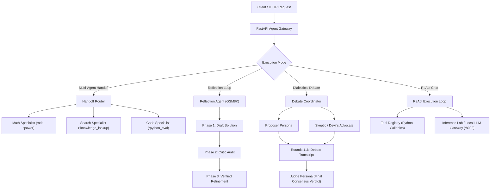

# Agent Orchestrator 🤖

A production-grade, local Multi-Agent Orchestration Framework built with Python and FastAPI.
This repository serves as **Foundation 2** of our advanced AI engineering portfolio, demonstrating production patterns for tool invocation, specialist routing, reflective self-correction, and multi-agent consensus.

---

## 🏛️ System Architecture



---

## 🚀 Milestones & Implementation Progress

### Milestone 1: ReAct Engine Core (Completed ✅)
* **Dynamic Schema Generation**: Inspects python functions via reflection (`inspect.signature`) to build dynamic tool schemas in [`core/prompt.py`](core/prompt.py).
* **Fault-Tolerant JSON Parsing**: Regex & markdown-aware tool-call extractor in [`core/parser.py`](core/parser.py) that extracts structured tool calls even from noisy text outputs.
* **Execution & Memory Loop**: ReAct agent loop in [`core/agent.py`](core/agent.py) with conversational memory traces, loop guards, and error handling.

### Milestone 2: Multi-Agent Handoff (Completed ✅)
* **Domain Specialists**: Modular `Specialist` agents in [`core/handoff.py`](core/handoff.py) equipped with domain-isolated tool registries (`math`, `search`, `code`).
* **Intelligent Router**: Classifies incoming queries via keyword heuristics and LLM intent reasoning, delegating execution with full context transfer.
* **Audit Tracing**: Returns full memory traces across both router and specialist execution.

### Milestone 3: Self-Reflection & Critique Loop (Completed ✅)
* **3-Phase Verification**: Implemented in [`core/reflection.py`](core/reflection.py) targeting multi-step reasoning problems (GSM8K-style).
* **Draft -> Critique -> Refinement**:
  1. *Generator*: Derives initial step-by-step reasoning draft.
  2. *Critic*: Audits draft for calculation errors, missing constraints, or false assumptions.
  3. *Refiner*: Produces definitive, peer-reviewed final derivation.

### Milestone 4: Multi-Agent Debate (Completed ✅)
* **Dialectical Synthesis**: Implemented in [`core/debate.py`](core/debate.py).
* **Multi-Persona Roles**: Proposer defends thesis, Skeptic attacks assumptions and identifies risks, and Judge analyzes the round-by-round debate transcripts to issue a balanced consensus ruling.

---

## 🧪 Comprehensive Automated Test Suite

The orchestrator includes **29 production automated tests** with 100% pass rate:

```bash
python -m pytest tests/ -v
```

* **`tests/test_agent.py`** (3 tests): Initialization, text-only generation, tool invocation and state updates.
* **`tests/test_advanced_orchestrator.py`** (6 tests): Tool execution exceptions, unregistered tools, loop limits, multi-step pipeline tools, debate rounds, fallback specialist routing.
* **`tests/test_parser.py`** (4 tests): Clean JSON, markdown codeblocks, malformed JSON recovery, missing key validation.
* **`tests/test_prompt.py`** (2 tests): Dynamic schema generation, system prompt formatting.
* **`tests/test_registry.py`** (3 tests): Tool registration, execution, missing tool error handling.
* **`tests/test_handoff.py`** (3 tests): Specialist execution, intent classification, end-to-end handoff orchestration.
* **`tests/test_reflection.py`** (1 test): 3-phase draft/critique/refine reasoning loop.
* **`tests/test_debate.py`** (1 test): Multi-round dialectical debate and final judge verdict.
* **`tests/test_server.py`** (6 tests): `/health`, `/v1/agent/chat`, `/v1/agent/handoff`, `/v1/agent/reflect`, `/v1/agent/debate`, schema validation.

**Result**: `29 passed, 100% test success rate`.

---

## 🛠️ Quickstart

### 1. Ensure Local Inference Server is Running
```bash
# In projects/inference-lab
python -m uvicorn server.app:app --host 0.0.0.0 --port 8002
```

### 2. Start Agent Orchestrator Server
```bash
# In projects/agent-orchestrator
python -m uvicorn server.app:app --host 0.0.0.0 --port 8001
```

### 3. API Examples

#### Multi-Agent Handoff
```bash
curl -X POST http://127.0.0.1:8001/v1/agent/handoff \
  -H "Content-Type: application/json" \
  -d '{"query": "Calculate 25 multiplied by 4", "max_steps": 3}'
```

#### Self-Reflection Reasoning Loop
```bash
curl -X POST http://127.0.0.1:8001/v1/agent/reflect \
  -H "Content-Type: application/json" \
  -d '{"problem": "A car travels 120 miles in 2 hours, then 180 miles in 3 hours. What is its average speed?"}'
```

#### Multi-Agent Debate
```bash
curl -X POST http://127.0.0.1:8001/v1/agent/debate \
  -H "Content-Type: application/json" \
  -d '{"topic": "Should software teams prefer Monoliths or Microservices for rapid early prototyping?", "rounds": 2}'
```
